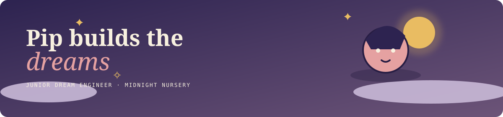

# haX.baby · Pip's Midnight Nursery

<p align="center">
  
</p>

An interactive early-web-inspired story portfolio for Pip, a junior dream engineer at the Midnight Nursery.

## The story

One night, a tiny neighborhood creature loses its favorite dream. Visitors follow Pip through four compact scenes: the midnight nursery, the discovery, the Lullaby Lab repair, and the delivery before first light. The work drawer contains the artifacts Pip uses along the way.

## Original interactions

- Four-step keyboard-accessible story player with progress and scene transitions.
- Extended bedtime routine section with a handwritten nursery card and Pip's three care steps.
- Lullaby mood selector, lantern lighting study, and hand-drawn delivery route.
- Opt-in synthesized click sounds with a visible sound toggle. Audio never starts automatically.
- Desktop-only sparkle cursor trail with reduced-motion and mobile fallbacks.
- Reversible Responsive Chaos Mode that rearranges the visual composition without changing reading order.
- Retro visitor counter and local-only guestbook wish response.
- Theme toggle and a five-click Pip surprise.

## Run locally

```bash
npm install
npm run dev
```

Production verification:

```bash
npm run build
```

## Credits

- Created by **Lovely Sharma**.
- Character and scene imagery: official haX.baby Pip Creator Asset Pack in [`public/assets/`](./public/assets/).
- Typography: Fraunces and DM Mono, loaded from Google Fonts.
- Illustration, layout, interactions, and animation: original project code in `src/`.
- No third-party audio files or persistence backend are used. Click sounds are generated locally with the Web Audio API after opt-in.

## Submission audit

- **Verified:** production build passes; local preview responds; asset paths resolve; story controls and bonus controls are implemented in source; reduced-motion CSS is present; images have dimensions and lazy loading where appropriate.
- **Not verified here:** public deployment URL, browser-console errors on a hosted deployment, and challenge-period commit history. The repository currently contains only the initial commit, so that history requirement needs to be completed by the submitter.
- **Not implemented:** persistent/live guestbook. The visible wish form is deliberately local-only and does not claim to upload or store visitor messages.